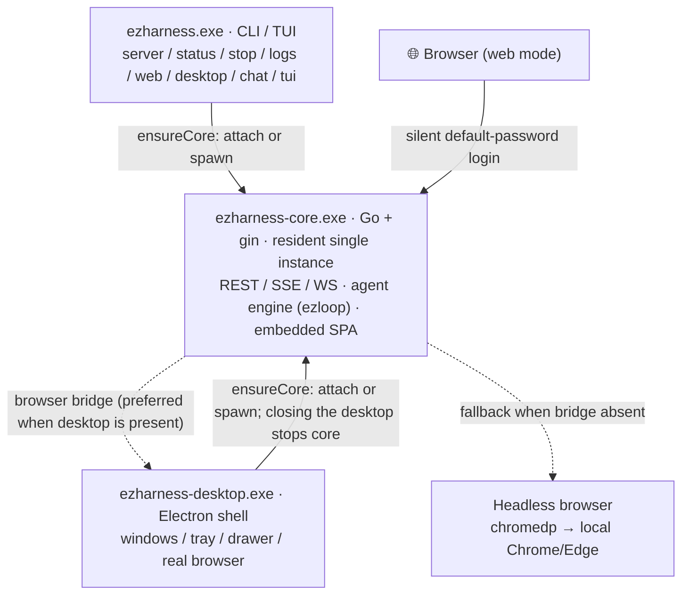

<!-- GIF checklist (auto-displays once added): docs/assets/overview.gif · first-chat.gif · fork.gif ·
     terminal.gif · browser.gif · board.gif · quickapp.gif · decision.gif -->

<div align="center">


# ezharness

**Simplicity, delivered to the user.**

Three executables · One resident core · Zero config — a desktop agent harness built for the simplest possible user experience

[](https://github.com/xuanlv2002/ezharness/releases)
[](https://github.com/xuanlv2002/ezharness/releases)
[](LICENSE)
[](https://xuanlv2002.github.io/ezharness/)
[](https://go.dev)
[](https://svelte.dev)
[](https://www.electronjs.org/)

[简体中文](README.md) · **English**

</div>

---

ezharness is an AI assistant that runs on your computer: it can read and write files across the whole machine, drive a real terminal and browser, and keeps every step visible and under your control. It believes an assistant harness only needs to do three things well —

| Pillar | Focus |
|---|---|
| **Context engineering** | What enters the context, when it folds, and how the model always knows who it is, where it is, and what the user just did |
| **Tool wrapping** | System capabilities (files, terminal, browser, whiteboard, MCP…) wrapped as safe, controllable, ready-to-use tools |
| **Interaction design** | Human-agent surfaces beyond the chat: decision cards, global notifications, shared terminal and browser |


## Features

- **Tree-shaped sessions** — Parallel branches; fork from any message to explore alternatives; compact archives a session into long-term memory without losing data; switching branches never interrupts background runs
- **Shared terminal** — Human and agent share one real shell: take over anytime while the agent works; the agent knows what you typed last round
- **Shared browser** — A real embedded Chromium on desktop: the AI operates via tools, you take over natively on the same page
- **Decision cards & global notifications** — Four approval levels (always ask / blacklist / whitelist / fully auto) applied instantly; when any branch needs a human, the notification always finds you
- **Magic whiteboard** — Object-model canvas: annotate screenshots or draw, and hand it back to the conversation as an attachment
- **Quick apps** — Small tools generated by the agent (HTML etc.) launch as child windows in one click, with direct MCP access
- **Scheduled callbacks** — Send a message to a chosen session (interrupting a running turn), auto-start a quick app and call its declared endpoint, or run a script in the work directory; session targets fail after archival/compaction, every run is recorded and notifies
- **MCP** — External tool servers (http / stdio): health checks, start/stop, hot reload
- **Triple memory** — Long-term memory (indexed into context, retrieved on demand) / capability memory (skills) / topic memory (session archives)
- **Three model slots** — main / image / audio, each with usage stats; image recognition relies on the main model's multimodal vision (no vision, no image input)
- **Security** — Password on first use, persistent per-client session tokens, separately revocable OpenAPI tokens; four approval levels; terminal commands blocked by substring match (better safe than sorry)

## Install

Grab a build from [Releases](https://github.com/xuanlv2002/ezharness/releases):

**Option 1: Windows installer**

1. Download `ezharness-desktop-v<version>-setup.exe` and run it;
2. It installs the desktop app, `ezharness.exe` (CLI/TUI) and `ezharness-core.exe` side by side; the checkbox (on by default) adds the install dir to the system PATH so `ezharness` works in any terminal for all users. Config and data live under `%APPDATA%\ezharness` and survive upgrades.

**Option 2: macOS / Linux**

The `.dmg` / `.AppImage` bundles the desktop app, the CLI and core together.

**Plain server (no desktop shell)**

Run `ezharness-core.exe` directly and open `http://127.0.0.1:<port>` in a browser — same page as the desktop app. Browser tools fall back to a headless local Chrome/Edge when the desktop shell is not around.

All three clients sign in silently with the default password `ezharness` — there is no login page; tokens persist and are renewed automatically. OpenAPI is fully independent of login and has no default token: the agent creates one with the `create_openapi_token` tool when needed, and scripts or quick apps pass it explicitly; the core never injects it into the environment.

## Up and running in 30 seconds

1. Open the "Models" page, enter your apiKey and pick a model;
2. Head back to the chat and hand over a task — file organization, scripting, error triage, web operations;
3. When the agent needs you (approval / question), a decision card shows up in the timeline and the notification corner.


## Core workflows

| Scenario | How |
|---|---|
| [Session forking](docs/md/session设计.md) | Click "fork" on any message to copy the prefix into a new branch; "compact" distills a long session into memory and starts a fresh generation |
| [Shared terminal](docs/md/协同设计.md) | Open the terminal drawer: watch and take over the agent's shell; your keystrokes feed back into its context |
| Shared browser | Ask the agent to "open and operate this page" — the browser window pops up for co-viewing; take over anytime |
| Magic whiteboard | Drop a screenshot on the board, annotate what to change, send it back to the agent |
| Quick apps | Ask the agent to "build a small tool page", then launch it as a child window |
| Scheduled callbacks | Create timers in the Callbacks page: send a message to a chosen session, auto-start a quick app and call its declared endpoint, or run a script; archived/compacted sessions fail, and run records and trigger notifications are available |
| MCP | Add MCP servers in settings; the agent discovers tools automatically; quick apps can call them too |


## Architecture at a glance

Three executables, one resident core: the CLI and the desktop app are both clients of the same core. Quitting the CLI leaves the core running; closing the desktop app (instead of minimizing it to the tray) stops the core, while minimizing to the tray keeps it running. The desktop settings page can also explicitly restart or stop the core process:



The core prepares a default password at startup and all clients log in silently; API auth uses the `EzHarnessToken` header (scripts and quick apps call `/api/open/*` with `EzHarnessOpenToken`). See [three-part architecture](docs/md/三分架构.md) (Chinese).

Division of labor with the sister repo [ezloop](https://github.com/xuanlv2002/ezloop): ezloop is a lean agent loop engine (model↔tool loop, hook / warp extension points, fork sub-agents); ezharness builds session management, context engineering, tool wrapping and interaction design on top.

## Documentation

The **[docs site](https://xuanlv2002.github.io/ezharness/)** supports Chinese/English switching and is organized from shallow to deep:

| Layer | Content | Entry |
|---|---|---|
| Getting started | Install, models, first chat | This page + [Get started](https://xuanlv2002.github.io/ezharness/#start) |
| User guide | Sessions / terminal / browser / whiteboard / quick apps / MCP | [User guide](https://xuanlv2002.github.io/ezharness/#guide) |
| Core concepts | Session tree, context engineering, human-agent interaction | [Core concepts](https://xuanlv2002.github.io/ezharness/#concepts) |
| Deep dives | Sessions, context, MCP, collaboration, quick apps | [Design](docs/md/设计理念.md) · [docs/md/](docs/md/) |

## Building from source

Prerequisites: [Go 1.26+](https://go.dev/dl/), [Node.js](https://nodejs.org/). To hack on [ezloop](https://github.com/xuanlv2002/ezloop) itself (release builds pull it from the module proxy — clone only if needed), point the `replace` in `core/go.mod` at your local ezloop checkout. Electron downloads are mirrored via npmmirror (`desktop/.npmrc`).

The version has a single source of truth in `script/version.yaml`. Scripts run from any directory:

```sh
script\dev.bat           # debug: build frontend + core/cli -> run Electron in the foreground
script\build.bat         # release: installer into release\v<version>\
script/dev.sh            # macOS / Linux equivalent of dev.bat
```

`release\dev\` ends up with the three executables side by side: `ezharness-core.exe` (can also run standalone), `ezharness.exe` (`ezharness tui` / `status` / `stop`), and `ezharness-desktop.exe`.

## Contributing

Issues and PRs are welcome. Before changing code, read [AGENTS.md](AGENTS.md) (dev memo: change-ripple checklists and known pitfalls); see the [docs site](https://xuanlv2002.github.io/ezharness/) for deep design notes.

## License

[Apache-2.0](LICENSE)

---

<div align="center">

**ezharness** — Simplicity, delivered to the user.

</div>
