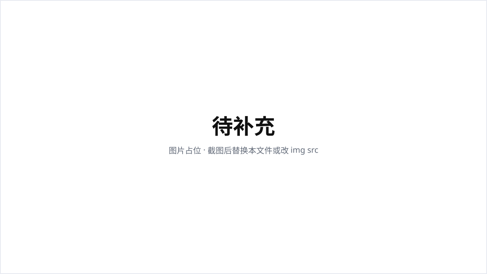
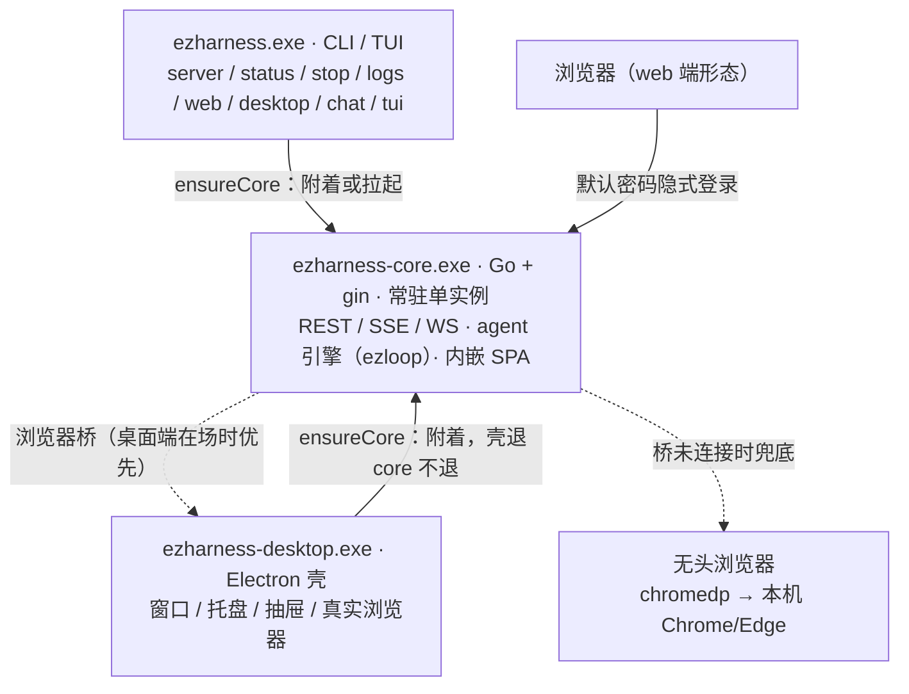

<div align="center">


# ezharness

**自己用着顺手，就分享给你。**

通用桌面智能体工作台：办公，创作，学习 -- 一站式Agent应用。

[](https://github.com/xuanlv2002/ezharness/releases)
[](https://github.com/xuanlv2002/ezharness/releases)
[](LICENSE)
[](https://xuanlv2002.github.io/ezharness/)
[](https://go.dev)
[](https://svelte.dev)
[](https://www.electronjs.org/)

**简体中文** · [English](README.en.md)

</div>

## 功能演示

<p align="center">
  
</p>

ezharness 把模型放进你的真实工作环境：文件、终端、浏览器都是真的，人和 agent 共用同一台电脑；图片、语音、视频生成也在同一张工作台上排队与交付。交付的成果沉淀为**快应用**——能被打开、复用、也会被下一次对话里的 agent 自己发现和调用；长对话折叠为摘要并换代，记忆由你确认后沉淀。

- **真实环境** —— 文件、终端、浏览器直接操作，不是模拟接口
- **共享终端** —— 人和 agent 写同一个 shell，它敲的命令你看得见、随时接管
- **共享浏览器** —— 内嵌真实 Chromium，同一个页面原生接管，不是截图转述
- **会话树** —— 任意消息点「分叉」开新线；「归档」压缩成交接摘要并换代，一条不丢
- **会话级偏好** —— 思考强度、审批档位、主模型每会话各一套；新会话从来源会话继承
- **多媒体生成** —— 图片 / 语音 / 视频独立配置模型，工作台、agent 工具与 OpenAPI 共用异步任务流与每日配额
- **快应用** —— agent 现场构建的独立小应用；可钉到左侧菜单在主窗打开，后端状态与日志在终端分组可见
- **定时回调** —— 到点向指定会话发消息（运行中先打断）、启动快应用调用声明端点，或执行工作目录里的脚本；会话归档/压缩换代后任务失败，每次触发留记录并通知
- **上下文工程** —— 修剪 / 摘要 / 卸载 + 三层记忆，聊得久不失忆
- **四档审批** —— 每次审批 / 黑名单 / 白名单 / 全免审，决定权留在人手里
- **MCP** —— http / stdio 接入，探活、启停、热加载；快应用也能直调
- **魔法画板** —— 丢一张截图圈注要改的地方，一键回填给 agent

<p align="center">
  
  
  
</p>

<p align="center">
  
  
</p>

<p align="center"><sub>多媒体工作台 · 会话级工具条：截图待补充</sub></p>

## 快速开始

从 [Releases](https://github.com/xuanlv2002/ezharness/releases) 下载：

- **Windows 安装包** `ezharness-desktop-v<版本>-setup.exe`：一次装好桌面端、CLI（`ezharness`）与 core（`ezharness-core.exe`），安装目录写入用户 PATH；配置与数据在用户数据目录（`%APPDATA%\ezharness`），升级不丢。
- **Windows 绿色版** `ezharness-desktop-v<版本>.exe`：放哪都行，配置与数据就在它旁边。
- **macOS / Linux**：`.dmg` / `.AppImage` 里带齐三件；也可以只下载 `ezharness` 与 `ezharness-core` 放同一目录，走命令行。
- **纯 server**：`ezharness-core.exe`（或 `ezharness server [--detach]`）起后端，浏览器访问 `http://127.0.0.1:<port>`，与桌面端同一份页面；`ezharness tui` 是终端界面，`ezharness --server <主机:端口> tui` 可连另一台 core。

三端用默认密码 `ezharness` 隐式登录，不显示登录页；会话令牌各自保存，失效自动重登。OpenAPI 与登录完全独立，没有默认令牌：agent 需要调用时用 `create_openapi_token` 工具生成，脚本/快应用显式带上，core 不做环境注入。

1. 打开「模型」页填入语言模型 apiKey，并点亮新会话的默认模型；需要生成图片/语音/视频时，到「多媒体 · 模型与限额」配置对应模型；
2. 回到对话页，把任务交给它——文件整理、脚本编写、报错排查、网页操作、生成素材都行；输入框上方可随时切换本会话的模型 / 思考强度 / 审批档位；
3. 它需要你时（审批 / 提问），决策卡会出现在时间线与顶栏通知里。

每个平台附 `SHA256SUMS` 校验文件；产物为 ad-hoc 签名，被系统拦截时（SmartScreen「更多信息 → 仍要运行」；macOS 右键「打开」）属正常现象。

## 核心玩法

| 场景 | 怎么玩 |
| --- | --- |
| [会话分叉](docs/md/session设计.md) | 对任意消息点「分叉」开新线，多方案并行对比 |
| [会话级偏好](docs/md/模型配置.md) | 输入框上方的模型 / 思考 / 审批只作用于当前分支；新建线继承来源会话 |
| [共享终端](docs/md/协同设计.md) | 工作区抽屉的终端里，agent 正在跑的命令你能看见、能接管 |
| 共享浏览器 | agent 打开网页操作，窗口自动弹出共见，你在同一页面随时接管 |
| [快应用](docs/md/快应用.md) | 让 agent 做个小工具，生成后一键启动，下次还能被它自己调用；钉住后从左侧菜单在主窗打开 |
| [多媒体生成](docs/md/多媒体.md) | 在「多媒体」页直接生成图片/语音/视频；agent 工具与 OpenAPI 的任务汇入同一工作台，按日配额、生成前审批 |
| [定时回调](docs/md/定时回调.md) | 在「回调」页设定时任务：到点给选定会话发消息、启动快应用调用声明端点，或执行脚本；归档/换代后失败，触发记录与通知可回看 |
| [MCP](docs/md/mcp设计.md) | 设置页添加 MCP server，agent 自动发现工具 |
| [认证与 OpenAPI](docs/md/认证与openapi.md) | 脚本 / 快应用 / 外部程序一套令牌直调模型、调用 MCP、提交多媒体生成 |

## 它由什么组成

三个 exe、一个常驻 core：CLI 与桌面端都是 core 的入口，退出它们都不停 core：



core 启动时备好默认密码，三端静默登录；接口鉴权用请求头 `EzHarnessToken`（脚本/快应用用 `EzHarnessOpenToken` 调 `/api/open/*`）。详见[三分架构](docs/md/三分架构.md)。

与姊妹仓库 [ezloop](https://github.com/xuanlv2002/ezloop) 的分工：ezloop 是精简的 agent loop 引擎；ezharness 在其上做会话管理、上下文工程、工具封装与人机交互设计。

## 文档

**[在线文档](https://xuanlv2002.github.io/ezharness/)**（支持中英文切换，按由浅入深组织）：[三分架构](docs/md/三分架构.md) · [模型配置](docs/md/模型配置.md) · [多媒体](docs/md/多媒体.md) · [session 管理](docs/md/session设计.md) · [上下文管理](docs/md/上下文设计.md) · [协同工具](docs/md/协同设计.md) · [快应用](docs/md/快应用.md) · [定时回调](docs/md/定时回调.md) · [skill 设计](docs/md/skill设计.md) · [MCP 设计](docs/md/mcp设计.md) · [认证与 OpenAPI](docs/md/认证与openapi.md) · [计划工具](docs/md/plan设计.md) · [设计理念](docs/md/设计理念.md)

## 从源码构建

前置：[Go 1.26+](https://go.dev/dl/)、[Node.js](https://nodejs.org/)。版本单源为 `script/version.yaml`，脚本可从任意目录调用：

```sh
script\dev.bat      # 调试：前端构建 + core/cli 编译，前台启动 Electron
script\build.bat    # 发布打包 -> release\v<版本>\

script/dev.sh       # macOS / Linux 同 dev.bat
```

产物 `release\dev\` 下三件并排：`ezharness-core.exe`（也可单独前台运行）、`ezharness.exe`（`ezharness tui` / `status` / `stop`）、`ezharness-desktop.exe`。

需要修改 [ezloop](https://github.com/xuanlv2002/ezloop) 本身时，在 `core/go.mod` 用 `replace` 指向本地仓库。

## 许可

[Apache-2.0](LICENSE)

---

<div align="center">

**ezharness** — 自己用着顺手，就分享给你。

</div>
