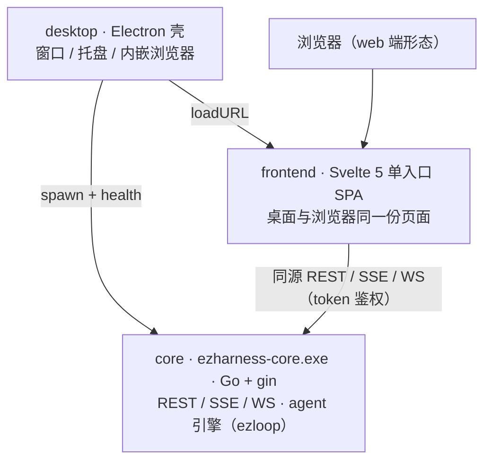

<div align="center">


# ezharness

**自己用着顺手，就分享给你。**

一个桌面智能体工作台：AI 直接在你的真实环境里干活，每一步可见、可接管。

[](https://github.com/xuanlv2002/ezharness/releases)
[](https://github.com/xuanlv2002/ezharness/releases)
[](LICENSE)
[](https://xuanlv2002.github.io/ezharness/)
[](https://go.dev)
[](https://svelte.dev)
[](https://www.electronjs.org/)

**简体中文** · [English](README.en.md)

</div>

## 功能演示

<p align="center">
  
</p>

ezharness 把模型放进你的真实工作环境：文件、终端、浏览器都是真的，人和 agent 共用同一台电脑。交付的成果沉淀为**快应用**——能被打开、复用、也会被下一次对话里的 agent 自己发现和调用；对话折叠为记忆，用得越久工作台越完整。

- **真实环境** —— 文件、终端、浏览器直接操作，不是模拟接口
- **共享终端** —— 人和 agent 写同一个 shell，它敲的命令你看得见、随时接管
- **共享浏览器** —— 内嵌真实 Chromium，同一个页面原生接管，不是截图转述
- **会话树** —— 任意消息点「分叉」开新线；「归档」把长对话蒸馏进记忆并换代，一条不丢
- **快应用** —— agent 现场构建、一键启动的独立小应用，沉淀为可被它自己再次调用的软件单元
- **上下文工程** —— 修剪 / 摘要 / 沉淀 + 三层记忆，聊得久不失忆
- **四档审批** —— 每次审批 / 黑名单 / 白名单 / 全免审，决定权留在人手里
- **MCP** —— http / stdio 接入，探活、启停、热加载；快应用也能直调
- **魔法画板** —— 丢一张截图圈注要改的地方，一键回填给 agent

<p align="center">
  
  
  
</p>

## 快速开始

从 [Releases](https://github.com/xuanlv2002/ezharness/releases) 下载。**exe 在哪运行，配置与数据就在哪生成。**

1. 下载 `ezharness-v<版本>.exe`（绿色版，可改名放入任意文件夹并加入 PATH），或使用安装包；
2. 打开「模型」页，填入 apiKey 并选择模型；
3. 回到对话页，把任务交给它——文件整理、脚本编写、报错排查、网页操作都行；
4. 它需要你时（审批 / 提问），决策卡会出现在时间线与顶栏通知里。

每个平台附 `SHA256SUMS` 校验文件；产物为 ad-hoc 签名，被系统拦截时（SmartScreen「更多信息 → 仍要运行」；macOS 右键「打开」）属正常现象。纯 server 形态：直接运行 `ezharness-core`，浏览器访问 `http://127.0.0.1:<port>`，与桌面端同一份页面。

## 核心玩法

| 场景 | 怎么玩 |
| --- | --- |
| [会话分叉](docs/md/session设计.md) | 对任意消息点「分叉」开新线，多方案并行对比 |
| [共享终端](docs/md/协同设计.md) | 工作区抽屉的终端里，agent 正在跑的命令你能看见、能接管 |
| 共享浏览器 | agent 打开网页操作，窗口自动弹出共见，你在同一页面随时接管 |
| [快应用](docs/md/快应用.md) | 让 agent 做个小工具，生成后一键启动，下次还能被它自己调用 |
| [MCP](docs/md/mcp设计.md) | 设置页添加 MCP server，agent 自动发现工具 |
| [认证与 OpenAPI](docs/md/认证与openapi.md) | 脚本 / 快应用 / 外部程序一套令牌直调模型与 MCP |

## 它由什么组成

三层结构，业务全在一个 Go sidecar 里，桌面壳只做壳：



与姊妹仓库 [ezloop](https://github.com/xuanlv2002/ezloop) 的分工：ezloop 是精简的 agent loop 引擎；ezharness 在其上做会话管理、上下文工程、工具封装与人机交互设计。

## 文档

**[在线文档](https://xuanlv2002.github.io/ezharness/)**（支持中英文切换，按由浅入深组织）：[模型配置](docs/md/模型配置.md) · [session 管理](docs/md/session设计.md) · [上下文管理](docs/md/上下文设计.md) · [协同工具](docs/md/协同设计.md) · [快应用](docs/md/快应用.md) · [skill 设计](docs/md/skill设计.md) · [MCP 设计](docs/md/mcp设计.md) · [认证与 OpenAPI](docs/md/认证与openapi.md) · [设计理念](docs/md/设计理念.md)

## 从源码构建

前置：[Go](https://go.dev/dl/)、[Node.js](https://nodejs.org/)。版本单源为 `script/version.yaml`，脚本可从任意目录调用：

```sh
script\dev.bat      # 调试：前端构建 + core 编译，前台启动 Electron
script\build.bat    # 发布打包 -> release\v<版本>\

script/dev.sh       # macOS / Linux 同 dev.bat
```

需要修改 [ezloop](https://github.com/xuanlv2002/ezloop) 本身时，在 `core/go.mod` 用 `replace` 指向本地仓库。

## 许可

[Apache-2.0](LICENSE)

---

<div align="center">

**ezharness** — 自己用着顺手，就分享给你。

</div>
