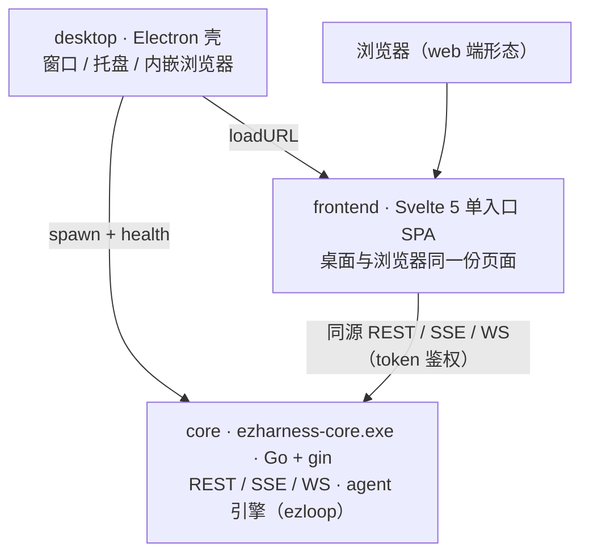

<div align="center">


# ezharness

**自己用着顺手，就分享给你。**

一个专注为用户提供最简单交互方案的桌面智能体 harness

[](https://github.com/xuanlv2002/ezharness/releases)
[](https://github.com/xuanlv2002/ezharness/releases)
[](LICENSE)
[](https://xuanlv2002.github.io/ezharness/)
[](https://go.dev)
[](https://svelte.dev)
[](https://www.electronjs.org/)

**简体中文** · [English](README.en.md)

</div>

## 功能演示

<p align="center">
  
</p>

## 不是聊天框，而是一张可持续进化的工作台

今天，一个 AI 助手的天花板很少是模型的能力与接口，而是两道缺口：它与真实世界之间的隔阂，以及一次对话结束后，几乎什么也没留下。

ezharness 把这两件事放进同一张工作台。模型直接站在真实环境里——文件、终端、浏览器都是真的，每一步都摊开在你的眼前；而每次交付的成果不会散落，它会沉淀为快应用，被你打开、复用，也会被下一次对话里的 agent 自己发现和调用。

用得越久，这张工作台越完整。你留下的不是一个越聊越忘的对话框，而是一套持续生长的能力。与此同时，**用户如何控制它、如何与它共存**，始终是这套设计的另一半。

它只解决三件事，并且认为除此之外都该交给模型自己判断：

| 支柱 | 真正的问题 |
| --- | --- |
| **上下文工程** | 不是塞得越多越好。是让模型在任何一刻都知道：我是谁、我在哪、用户刚做了什么；折叠掉的对话沉淀为记忆，而不是被丢掉 |
| **工具封装** | 工具不是一张 API 清单，而是一条边界。审批、卸载、超时、并发，每一处都在「能做」与「该做」之间划线 |
| **交互方案设计** | 对话不足以协同。终端、浏览器、画板、决策卡，是把「AI 替我做事」变成「我看着它做，随时能接手」 |

## 我们的答案

怎么把世界交给它，又怎么把你留在旁边——下面四件事就是回答。

### 会话是一棵树，不是一条时间线

线性的聊天记录是机器日志，不是人思考的形状。

ezharness 的会话树只向用户暴露两个动作：**分叉**（fork，复制到某条消息之前的完整前缀，开一条新线）和 **归档**（compact，把长对话蒸馏进记忆并换代）。旧世代沿压缩链懒加载，一条都不丢；切换分支不打断后台正在跑的任务。

一条线走不通，不必清空重来——让它在旁边长成另一条线。

### AI 和你共用同一台电脑

大多数产品把 AI 关进沙箱，再给它几个模拟世界的接口。ezharness 反过来：**让 AI 直接站在你的工作环境里。**

- **共享终端**：人和 agent 共用同一个真实 shell。它正在敲什么命令你看得见，随时接管；你敲的命令，它下一轮就知道。
- **共享浏览器**：内嵌真实 Chromium。AI 通过工具操作页面，你在同一个页面原生接管——所见即所得，不是截图转述。

能力越强，越需要「可见、可接管、可追责」。四档审批策略（每次审批 / 黑名单 / 白名单 / 全免审）不是安全装饰，而是把最终决定权留在人手里的那根线。

### 快应用：agent 的产出不是代码块，是可运行的应用

聊天窗口里的代码是草稿。真正的交付物应该能被打开、运行、复用，并在下一次被 agent 自己发现和调用。

**快应用（quick app）是 ezharness 定义的一种应用形态**：AI 现场构建、快速迭代、人与 agent 共用。它不绑定技术栈——纯 HTML 页面可以，带本机后端也可以。协议只回答三个问题：**如何被发现、如何启动、如何描述自己。**

```
apps/<app-id>/
├── app.quick          # 应用声明（唯一硬契约）
├── index.html         # entry 指向的入口，必须在应用目录内
├── APP.md             # 应用文档：agent 能否调用、怎么调用
└── ...                # 其余文件完全由应用自己组织
```

```json
{
  "title": "证书探测",
  "description": "探测域名 HTTPS 证书链与到期时间",
  "version": "1.3.0",
  "entry": "index.html",
  "backend": "python server.py",
  "icon": "icon.svg",
  "document": "APP.md"
}
```

这套协议里最关键的三个决定：

1. **目录名即身份，未识别字段一律忽略。** `app-id` 创建后不改；新字段不会破旧内核，旧应用也不会因升级失效。协议向前兼容是设计出来的，不是碰巧。
2. **能否被 agent 调用，由应用自己的文档决定，不由内核开关决定。** `APP.md` 里有「Agent 调用」一节，应用才向模型开放；没有就只面向人类。内核不提供统一的 `app_call` 转发——因为调用方式必须由应用定义（前端 JS、HTTP、CLI 都行），**框架不该把应用形态写死**。
3. **同源伺服，令牌转交。** 页面由 core 在 `/apps/<app-id>/` 同源提供，打开时入口 URL 带上访问令牌，HTML 响应注入令牌桥，页内 `fetch('/api/...')` 自动带上 `X-EZ-Token`。应用自己不需要保管密钥；带后端的应用前台运行，日志与生命周期都归用户可见。

对内，每个应用的清单常驻系统提示（`<apps>` 段），新增、更新、移除经 `<resource_change>` 增量上报，`load_app` 读取完整文档与变更历史——和技能库同构。模型因此不必猜「现在有哪些应用、哪个能调、怎么调」。

更关键的是方向：**应用封装 MCP 工具 → agent 使用应用、组装流程 → 再把流程固化成新的应用。** 固化之后，常规路径由代码执行，不再每轮回到 agent loop 里推理：确定、快、可改；需要判断的片段仍可调用模型。skill 教模型每次怎么做，快应用把做法直接写成代码。

一句话：**让 agent 从「写出一段代码」走到「交付一个可被它自己再次使用的软件单元」。**

### 上下文不是缓冲区，是记忆的工作台

ezharness 在每轮对话里持续做三件事：**修剪**（按窗口水位就地截断）、**摘要**（已完成 / 正在做 / 待办 / 关键事实四段结构）、**沉淀**（把折叠掉的对话蒸馏进长期记忆）。

加上三层记忆——长期记忆（索引进上下文、按需检索）、能力记忆（做过一次的操作固化为 skill）、话题记忆（完整会话树归档）——模型不会因为聊得久就失忆，也不会因为上下文变长而变笨。

## 快速开始

从 [Releases](https://github.com/xuanlv2002/ezharness/releases) 下载。**exe 在哪运行，配置与数据就在哪生成。**

**绿色版（免安装）**

1. 下载 `ezharness-v<版本>.exe`（可改名 `ezharness.exe`），放入任意文件夹，如 `D:\ezharness`；
2. 将该文件夹加入 PATH；
3. 终端输入 `ezharness` 启动，首次运行在同目录生成 `ezharness.json` 与 `data\`。

**安装包**

1. 下载并运行安装包；
2. 按引导选择安装目录，自动创建开始菜单与桌面快捷方式，可选「添加到 PATH」。

**校验与系统拦截**

每个平台附 `SHA256SUMS-<win32|darwin|linux>.txt`，安装前可校验（文件名与哈希应为同一行）：

- Windows（PowerShell）：`Get-FileHash .\ezharness-v<版本>-setup.exe -Algorithm SHA256`
- macOS / Linux：`shasum -a 256 <文件>` 或 `sha256sum <文件>`

产物为 ad-hoc 签名、未做 Apple 公证，系统仍会拦截：

- Windows SmartScreen「Windows 已保护你的电脑」→ 更多信息 → 仍要运行。
- macOS 首次打开可能提示「无法验证开发者」→ 右键「打开」；若提示「已损坏」，执行 `xattr -dr com.apple.quarantine /Applications/ezharness.app`。
- macOS 安装包当前为 arm64（Apple Silicon）；Intel 机器请自行构建。

**纯 server 形态**

直接运行 `ezharness-core.exe`，浏览器访问 `http://127.0.0.1:<port>`。与桌面端同一份页面，桌面专属能力（如浏览器控制）自动降级。

### 30 秒上手

1. 打开「模型」页，填入 apiKey 并选择模型；
2. 回到对话页，把任务交给它——文件整理、脚本编写、报错排查、网页操作都行；
3. 它需要你时（审批 / 提问），决策卡会出现在时间线与顶栏通知里。

## 其他能力

- **MCP**：接入外部工具服务器（http / stdio），探活、启停、热加载；快应用也能直调
- **魔法画板**：丢一张截图进去，圈注要改的地方，一键回填给 agent
- **模型三槽**：main / image / audio 单选槽位，各自带用量统计；图片识别由主模型多模态承担
- **安全**：全 API 令牌鉴权（主界面、快应用页与终端脚本统一使用同一令牌）；终端命令含 shell 拼接元字符即转审批；浏览器导航/脚本/上传与应用写入默认审批

## 核心玩法

| 场景 | 怎么玩 |
| --- | --- |
| [会话分叉](docs/md/session设计.md) | 对任意消息点「分叉」开新线，多方案并行对比；「归档」把长对话沉淀为记忆并换代 |
| [共享终端](docs/md/协同设计.md) | 拉开工作区抽屉的终端：agent 正在跑的命令你能看见、能接管 |
| 共享浏览器 | 让 agent 打开网页操作，浏览器窗口自动弹出共见；你在同一页面随时接管 |
| [快应用](docs/md/快应用.md) | 让 agent 做个小工具，生成后一键启动为独立窗口，下次还能被它自己调用 |
| [MCP](docs/md/mcp设计.md) | 设置页添加 MCP server，agent 自动发现工具 |

## 它由什么组成

三层结构，业务全在一个 Go sidecar 里，桌面壳只做壳：



与姊妹仓库 [ezloop](https://github.com/xuanlv2002/ezloop) 的分工：ezloop 是精简的 agent loop 引擎（模型与工具的循环、hook / warp 扩展点、fork 分身）；ezharness 在其上做会话管理、上下文工程、工具封装与人机交互设计。

## 文档

**[在线文档](https://xuanlv2002.github.io/ezharness/)**（支持中英文切换，按由浅入深组织）：

| 层 | 内容 | 入口 |
| --- | --- | --- |
| 快速上手 | 安装、配置模型、第一轮对话 | 本页 |
| 模型与用量 | 槽位、协议、厂商预设、统计口径 | [模型配置](docs/md/模型配置.md) |
| 会话与上下文 | 树状会话、归档换代、修剪与记忆 | [session 管理](docs/md/session设计.md) · [上下文管理](docs/md/上下文设计.md) |
| 协同与交付 | 共享终端、浏览器、资源、快应用 | [协同工具](docs/md/协同设计.md) · [快应用](docs/md/快应用.md) |
| 扩展面 | 技能、MCP 与对外 API、工具边界 | [skill 设计](docs/md/skill设计.md) · [MCP 设计](docs/md/mcp设计.md) · [工具快查](docs/md/external.md) |
| 设计总述 | 取舍与边界 | [设计理念](docs/md/设计理念.md) |

## 从源码构建

前置依赖：[Go](https://go.dev/dl/)、[Node.js](https://nodejs.org/)（含 npm）。Electron 下载已配 npmmirror 镜像（`desktop/.npmrc`）。

版本单源为 `script/version.yaml`，构建时自动同步页脚与打包版本。脚本可从任意目录调用：

```sh
script\dev.bat           # 调试：前端构建 + core 编译，前台启动 Electron
script\build.bat         # 发布打包 -> release\v<版本>\ 安装包 + 绿色版

script/dev.sh            # macOS / Linux 同 dev.bat；5260 占用时自动换端口
```

需要修改 [ezloop](https://github.com/xuanlv2002/ezloop) 本身时，在 `core/go.mod` 用 `replace` 指向本地仓库。

## 贡献

欢迎 issue 与 PR。文档与设计说明见[在线文档](https://xuanlv2002.github.io/ezharness/)；构建流程见上节。

## 许可

[Apache-2.0](LICENSE)

---

<div align="center">

**ezharness** — 自己用着顺手，就分享给你。

没想创造什么，也没想发明什么，只是想做一些自己喜欢的事情。

</div>
